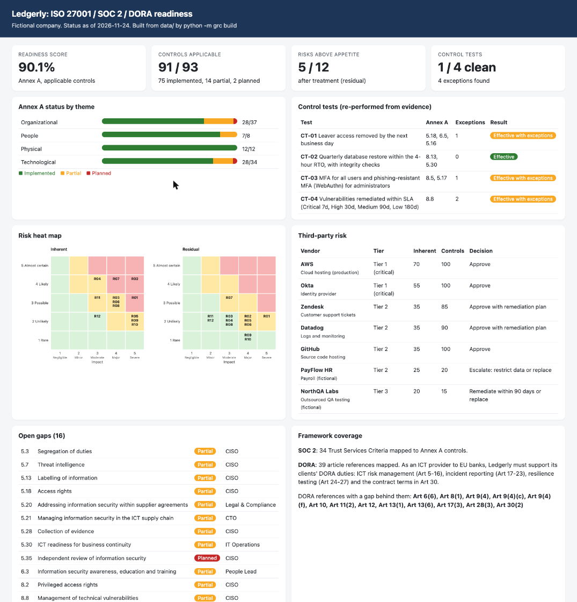
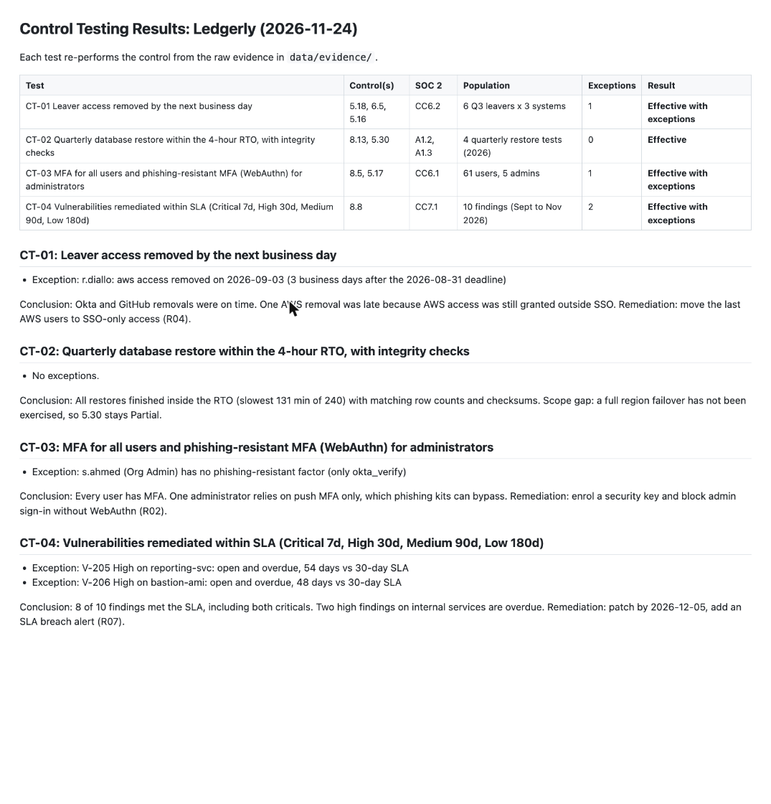
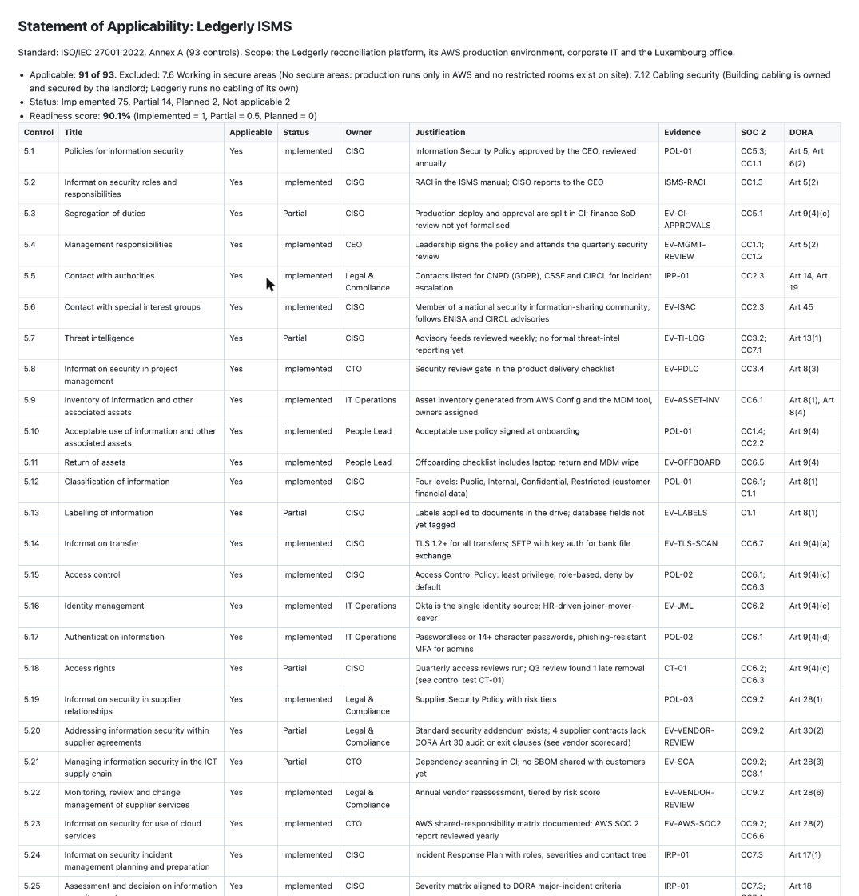

# GRC Readiness Pack: ISO 27001, SOC 2 and DORA for a Fintech SaaS

A full information security management system (ISMS) readiness pack for **Ledgerly**, a fictional 60-person software company in Luxembourg that sells reconciliation software to EU banks. It shows the work a GRC analyst does to get a company ready for an ISO 27001 certification audit and a SOC 2 Type II report, and ready for the DORA requirements its bank customers will push down to it.

Everything is generated from data by a small Python tool (`python -m grc build`), so the Statement of Applicability, risk register, vendor scorecard, control test results and dashboard always agree with each other.

**Author:** Marie Haccandy, M.S. Cybersecurity Management · [LinkedIn](https://www.linkedin.com/in/marie-christine-haccandy-24b6b21ba) · [GitHub](https://github.com/mhacc001)



## At a glance

| Area | Result |
|---|---|
| ISO 27001:2022 Annex A | All **93 controls** assessed. **91 applicable**: 75 implemented, 14 partial, 2 planned. Readiness score **90.1%**. |
| Exclusions | 2 controls (7.6 secure areas, 7.12 cabling), each with a written justification |
| Risk register | 12 risks scored 5x5, inherent and residual. **5 still above appetite** after treatment, each with an owner and a plan |
| Control testing | 4 controls re-performed from raw evidence: **1 effective, 3 effective with exceptions, 4 exceptions** in total |
| Third-party risk | 7 vendors tiered and scored. 2 approved with remediation for missing DORA contract terms, 1 escalated |
| Framework mapping | 34 SOC 2 Trust Services Criteria and 39 DORA article references mapped to Annex A |
| Policies | Information Security Policy, Access Control, Supplier Security, Incident Response Plan |

## Why DORA is in a SOC 2 / ISO project

The **Digital Operational Resilience Act** (EU 2022/2554) has applied since 17 January 2025. It binds banks, not their software vendors. But each bank must:
- manage its ICT third-party providers
- put specific contract terms in place with them (Art 30): audit rights, incident assistance, exit plans, data location
- report major ICT incidents within hours

A vendor like Ledgerly can only keep bank customers if it can meet those terms. So the pack maps every relevant DORA article to the controls that let Ledgerly support it ([reports/dora-mapping.md](reports/dora-mapping.md)). The Incident Response Plan notifies banks within 4 hours, because DORA gives the bank 4 hours from classification for its initial report.

## What is in the pack

| Deliverable | File | What it shows |
|---|---|---|
| ISMS scope and context | [docs/00-isms-scope-and-context.md](docs/00-isms-scope-and-context.md) | Clauses 4.1 to 4.3: issues, interested parties, scope statement, AWS carve-out |
| Statement of Applicability | [reports/statement-of-applicability.md](reports/statement-of-applicability.md) (+ CSV) | All 93 controls: applicability, status, owner, justification, evidence, SOC 2 and DORA references |
| Gap remediation plan | [reports/gap-remediation-plan.md](reports/gap-remediation-plan.md) | The 16 controls that are not fully implemented, with owners |
| Risk register and heat maps | [reports/risk-register.md](reports/risk-register.md), [inherent](reports/risk-heatmap-inherent.svg) / [residual](reports/risk-heatmap-residual.svg) | 5x5 method, appetite bands, controls per risk |
| Vendor scorecard | [reports/vendor-scorecard.md](reports/vendor-scorecard.md) | Inherent risk vs control strength, tier, decision, gaps |
| Control testing | [reports/control-testing.md](reports/control-testing.md) | Re-performance of 4 controls from evidence, with exceptions and conclusions |
| SOC 2 mapping | [reports/soc2-mapping.md](reports/soc2-mapping.md) | One control set, two frameworks |
| DORA mapping | [reports/dora-mapping.md](reports/dora-mapping.md) | Articles 5 to 30 mapped to controls, weakest status per article |
| Policies | [docs/policies/](docs/policies/) | Four approved policies with owners and review dates |
| Dashboard | [reports/dashboard.html](reports/dashboard.html) | One page for leadership: readiness, risks, tests, vendors, gaps |

## Control testing: findings, not just paperwork

Each test reads the raw evidence in [data/evidence/](data/evidence/) and re-performs the control the way an auditor would:

| Test | What was checked | Finding |
|---|---|---|
| CT-01 Leaver access | 6 Q3 leavers x 3 systems, deadline = next business day | One AWS removal 3 business days late, because that user still had access outside SSO. A Saturday leaver removed on Monday is correctly counted as on time. |
| CT-02 Backup restore | 4 quarterly restores vs a 4-hour RTO, row counts and checksums | Effective (slowest restore 131 minutes). Region failover never tested, so control 5.30 stays Partial. |
| CT-03 MFA | 61 users and 5 admins | Everyone has MFA. One admin has push-only MFA with no phishing-resistant factor. |
| CT-04 Vulnerability SLA | 10 findings vs Critical 7d / High 30d / Medium 90d / Low 180d | Both criticals fixed in time. Two high findings are overdue (54 and 48 days). |

Every exception is linked back to a risk (R02, R04, R07) and to a Partial control in the Statement of Applicability. A finding updates the risk picture instead of sitting in a separate spreadsheet.



## Third-party risk

Each vendor gets two scores:
- **Inherent risk** (0-80): data sensitivity, critical function, data outside the EU
- **Control strength** (0-100): certification, breach-notice time, MFA, encryption, pen test, and the two DORA Art 30 contract terms (audit right, exit plan)

The result:
- **AWS, Okta and GitHub** are approved.
- **Zendesk and Datadog** are approved with a remediation plan, because their contracts lack the DORA audit and exit terms.
- **The payroll provider** is escalated: no certification, no MFA, no breach-notice commitment.
- **The QA contractor** gets 90 days to remediate.

## Statement of Applicability



## Run it

```bash
python3 -m grc build --as-of 2026-11-24     # writes everything in reports/
open reports/dashboard.html
python3 -m pip install pytest && python3 -m pytest -q   # 8 tests
```

Change any file in `data/`, such as a control status, a risk score, a vendor answer or a new evidence row, and rebuild. Every report updates together.

## Layout

```
data/controls.csv          93 Annex A controls with Ledgerly's decisions and mappings
data/risk_register.csv     12 risks, inherent and residual scores, linked controls
data/vendors.csv           7 suppliers and their security answers
data/evidence/             raw evidence for the control tests
grc/soa.py                 Statement of Applicability, readiness, SOC 2 and DORA coverage
grc/risk.py                scoring, appetite bands, SVG heat maps
grc/vendors.py             third-party tiering and decisions
grc/testing.py             control tests CT-01 to CT-04
grc/dashboard.py           single-page HTML dashboard
docs/                      ISMS scope and the four policies
reports/                   generated output (committed so it can be read on GitHub)
```

## Related work

- [grc-lab](https://github.com/mhacc001/grc-lab): NIST CSF 2.0 program in Eramba and CISO Assistant
- [identity-governance-lab](https://github.com/mhacc001/identity-governance-lab): access certification and separation of duties in code
- [iam-lab-okta](https://github.com/mhacc001/iam-lab-okta): RBAC and MFA policy deployed to a live Okta org

Ledgerly, its people, vendors marked fictional and all evidence are invented for this lab. Control references follow ISO/IEC 27001:2022 Annex A, the AICPA 2017 Trust Services Criteria and Regulation (EU) 2022/2554 (DORA).
